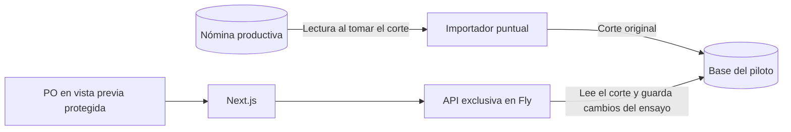

# Piloto de nómina

## Estado al 24 de noviembre de 2026

La rama de integración es `pilot/payroll-v2`. Parte de `master` en `fe71dbd8` e incorpora la interfaz que el PO terminó en `prototype/payroll-ui`, revisión `3f18f4aa`. La API productiva consultada identificó su versión como `6239a23a`. El acceso de operación diaria sigue en [Nómina productiva](https://nomina.keysarcosmetics.com/).

La [vista previa protegida de la rama](https://keysarcosmetics-payroll-git-pilot-payroll-v2-minnicas-projects.vercel.app/login) y la [API de pruebas](https://cosmetics-payroll-pilot.fly.dev/health) están desplegadas. El usuario del PO es `nomina`. Vercel solicita autenticación al visitante y la aplicación solicita su propia clave. La cuenta del piloto sin sesión recibe HTTP 401 en `/cut`. La [comprobación del corte](https://cosmetics-payroll-pilot.fly.dev/ready) devuelve HTTP 200.

El proyecto Supabase `keysar-payroll-pilot` (referencia `yopfaxxvlcpcfzxvqmfw`, región `us-west-1`) se creó en la organización separada **Keysar Nómina Piloto** (ID `kcjljutclkiovawrtxpr`) con el plan Free predeterminado. El propietario eligió este destino para mantener el costo adicional de Supabase en US$0. La CLI oficial creó el proyecto con el tamaño predeterminado. El MCP existente sólo tiene alcance en la organización original `minnica`. Allí había cotizado US$10 mensuales para otro proyecto en Pro. [Proyecto de Supabase](https://supabase.com/dashboard/project/yopfaxxvlcpcfzxvqmfw) · [Facturación de la organización piloto](https://supabase.com/dashboard/org/kcjljutclkiovawrtxpr/billing) · [Condiciones de Supabase](https://supabase.com/kb/troubleshooting/keeping-free-projects-after-pro-upgrade-Kf9Xm2).

**Corte de entrega**. El 24 de noviembre de 2026 a las 21:14:51 CDMX se cargó el corte `512a009f-46dc-453c-b690-12bc7e58404c`, con revisión inicial 0. Contiene 71 empleados, 396 ventas y 56 registros de préstamos o adelantos. La corrida aprobada del 16 al 31 de octubre tiene 64 líneas. El borrador del 16 al 30 de noviembre tiene 55 líneas.

**Prueba de aceptación ejecutada**. En la vista previa desplegada, un navegador inició sesión, registró y aprobó un bono de prueba de MX$12.34 para un empleado del corte abierto. La conciliación cambió exactamente MX$12.34 y conservó el cambio tras recargar. Se compararon las líneas, estados de recibos, préstamos, cuotas y movimientos leídos de producción antes y después. Coincidieron. También coincidieron el original y las referencias del piloto. La prueba quedó en el corte anterior, en revisión 2. El corte de entrega comenzó limpio. Se revocó el acceso temporal de la prueba automatizada de Vercel.

## Cómo lo usará el PO

1. Abrir la vista previa de Vercel con la cuenta autorizada y luego ingresar con el usuario del piloto `nomina` y su clave exclusiva. Obtener esa clave por el canal privado habitual.
2. Revisar el aviso **PRUEBA · Nómina** y la fecha del corte en hora de Ciudad de México. Los cambios posteriores en producción se incorporan al generar otro corte.
3. Abrir **Conciliar importes**, elegir la quincena cerrada e identificar las diferencias por empleado y por sucursal. La pantalla indica si los importes oficiales provienen de una corrida pagada, aprobada, en borrador o de un cálculo del motor vigente. Las diferencias se expresan en MXN como piloto menos referencia.
4. Cambiar a la quincena abierta. Ensayar, por ejemplo, la aprobación de un bono. Esperar **Guardado**, recargar y revisar la diferencia. Un conflicto entre pestañas conserva la última revisión guardada. Revisar los cambios pendientes antes de recargar. El PIN `0000` sirve para ensayar autorizaciones sólo después del ingreso real.
5. Probar también el abono de un préstamo, el recibo y la dispersión. Los archivos de salida llevan la marca **PRUEBA**. Para efectuar el pago o emitir el recibo oficial, usar [Nómina productiva](https://nomina.keysarcosmetics.com/).
6. Si un importe difiere, anotar la fecha del corte, la quincena, el ID de empleado o sucursal, el concepto, la referencia, el importe del piloto y los pasos realizados. Mantener nombres y montos individuales dentro de los canales internos de nómina.

### Entrega de la clave desde la PC del propietario

Las credenciales del piloto se guardan cifradas por Windows para el usuario que ejecutó la configuración. En PowerShell, este comando copia al portapapeles la clave de `nomina` para entregarla al PO por el canal privado habitual.

```powershell
(Import-Clixml "$env:LOCALAPPDATA\Keysar\PayrollPilot\yopfaxxvlcpcfzxvqmfw\operador.xml").GetNetworkCredential().Password | Set-Clipboard
```

Los archivos `runtime.xml`, `loader.xml` y `session.xml` del mismo directorio son exclusivos del responsable técnico. La credencial administrativa del nuevo proyecto está en el directorio hermano `kcjljutclkiovawrtxpr`. En otra PC se necesita recuperar las credenciales mediante el propietario o rotarlas. La vista previa admite que el propietario conceda acceso al correo del PO desde Vercel si aparece **Request Access**.

## Entornos y flujo de datos

| Componente | Recurso | Permisos |
| --- | --- | --- |
| Producción | `master`, dominio de nómina, proyecto Supabase `kgzuamipstbsiqrlaphh` | El importador hace una transacción de lectura consistente. |
| Copia | Proyecto PostgreSQL independiente, esquema `payroll_pilot` | El cargador crea el corte. La cuenta de ejecución sólo lee el original y guarda los cambios del ensayo. |
| API del piloto | Aplicación Fly `cosmetics-payroll-pilot` | Sesión independiente, lectura del último corte y guardado con revisión. |
| Interfaz del PO | Proyecto Vercel `keysarcosmetics-payroll`, entorno `preview` con `gitBranch=pilot/payroll-v2` | El servidor de Next dirige las solicitudes a la API del piloto. El navegador usa una cookie HttpOnly. |



El importador usa `REPEATABLE READ` y `READ ONLY`. La referencia cruda y los cambios se guardan en columnas diferentes. Cada guardado verifica el identificador del corte y su revisión bajo un bloqueo transaccional. Una pestaña con un corte anterior recibe HTTP 409. Cada nueva carga abre un ensayo limpio y conserva los anteriores en la base piloto. Actualizar un corte con el PO a mitad de una prueba requiere coordinarlo con él.

## Qué representa el corte

[Consulta de extracción](../backend/api/pilot/read-cut.sql) y [contrato de datos](../packages/types/src/payroll-pilot.ts).

- Se elige la quincena de la fecha de extracción en Ciudad de México y la corrida pagada o aprobada más reciente anterior a ella. Cuando aún no hay corrida cerrada se usa la quincena anterior. Para cada quincena se prefiere una corrida pagada, luego aprobada y después borrador.
- Se copian los nombres e identificadores necesarios para reconocer empleados, puestos, sucursales, sueldo, ventas por vendedor y sucursal, versiones y tramos de comisiones, asignaciones, catálogo, movimientos distribuidos, préstamos y cuotas. Las líneas de corrida, costos por sucursal y el estado del recibo dan la referencia. Quedan fuera clientes, cuentas bancarias, CLABE, teléfonos, correo, claves, archivos y notas libres del origen.
- Con corrida disponible se usan las líneas registradas, incluso si la corrida sigue en borrador. Sin corrida se usa `calculatePayroll` con el corte congelado para obtener la referencia por empleado. La conciliación de sucursal compara el costo de personal. No incluye gastos generales de la sucursal.
- El sistema de origen no proporciona las fechas laborales y tasas fiscales que solicita la propuesta. Se presupone la quincena completa para el sueldo y tasas nuevas en cero. Para empleados inactivos se habilitan las quincenas con actividad o una línea observada hasta que el PO registre fechas. La categoría inicial se infiere del puesto, y los módulos iniciales, del sueldo y las asignaciones. Las asignaciones y reglas nuevas se pueden ensayar en el piloto.
- Los calendarios de préstamos y saldos oficiales se conservan en el original. El prototipo reparte las cuotas según sus propias reglas. Los suministros entran como ajustes positivos en el prototipo. Los módulos nuevos, como finiquitos, aguinaldos y metas de kiosco, empiezan sin movimientos inventados.
- En dispersión se muestran cuentas vacías o de prueba. Las confirmaciones, autorizaciones y recibos modifican el ensayo. El proceso de la API carece de conectores bancarios, de mensajería y de escritura en las tablas operativas.

## Habilitar una base y cargar el corte

1. Para continuar con este piloto, usar el proyecto existente `yopfaxxvlcpcfzxvqmfw`. Verificar con `npx supabase projects list` que pertenece a la organización Free `kcjljutclkiovawrtxpr`. Si se configura otro MCP, autorizar esa organización. En una instalación nueva, verificar el plan y la cotización antes de crear otro proyecto. La organización productiva es `minnica`, con ID `vcdbwpyyntkgxurjkosn`. La región del piloto es `us-west-1`. Comprobar que la referencia de destino difiere de `kgzuamipstbsiqrlaphh`. El importador comprueba el hostname o la identidad del pooler y exige TLS.
2. En una sesión privada del cargador, inyectar `PILOT_PROJECT_REF` y `PILOT_DATABASE_URL` (conexión administrativa **del destino**) y las claves distintas `PILOT_RUNTIME_PASSWORD` y `PILOT_LOADER_PASSWORD` (aleatorias en base64url de 32 a 100 caracteres). Obtener los secretos del gestor de credenciales interno. Ejecutar desde la raíz del monorepo.

```sh
pnpm install --frozen-lockfile
pnpm --filter @cosmetics/api build
node backend/api/dist/pilot/import.js init
```

El comando verifica la ausencia de tablas operativas, crea la marca de identidad, activa RLS y crea los dos roles. `keysar_pilot_runtime` lee y guarda cambios por columna. `keysar_pilot_loader` sólo lee y agrega cortes. Las contraseñas se convierten en verificadores SCRAM antes de emitir el SQL. Al repetir `init` se conserva la contraseña de un rol ya existente.

3. Cambiar `PILOT_DATABASE_URL` a la conexión del rol `keysar_pilot_loader` en el destino. Añadir `PAYROLL_SOURCE_REF=kgzuamipstbsiqrlaphh` y `PAYROLL_SOURCE_READ_URL` únicamente a esa sesión. Preferir una credencial de sólo lectura con permiso de consulta sobre las tablas de la extracción. `PILOT_AS_OF` admite una fecha ISO si se requiere reconstruir una selección histórica de periodos. La información observada sigue siendo la de la fecha de extracción. Ejecutar el importador.

```sh
node backend/api/dist/pilot/import.js import
```

4. Montar en Fly únicamente `PILOT_PROJECT_REF`, `PILOT_DATABASE_URL` con el rol **keysar_pilot_runtime** del destino, `PILOT_OPERATOR_USER`, `PILOT_OPERATOR_HASH` (bcrypt) y `PILOT_SESSION_SECRET` (aleatorio de al menos 32 caracteres). El acceso de origen pertenece sólo a la sesión del importador. Entregar la clave del operador directamente al PO por el canal privado. La sesión dura dos horas.
5. Configurar `PILOT_API_ORIGIN=https://cosmetics-payroll-pilot.fly.dev` en la rama de Vercel `pilot/payroll-v2` para `preview`. Desplegar la API independiente desde la raíz con `fly deploy --app cosmetics-payroll-pilot --config backend/api/fly.payroll-pilot.toml --ha=false`. La vista previa se construye a partir de la rama. El build de esta rama rechaza `VERCEL_ENV=production`.
6. Verificar `GET /health`, `GET /ready` y el ingreso del PO desde la vista previa. `/ready` debe devolver 200, la API debe rechazar la lectura sin sesión y una sesión del PO debe obtener el corte correcto. Antes de dar acceso, confirmar que la protección de la vista previa pide autorización. Conservar sólo las credenciales de servicio del piloto en Fly.

### Refrescar en esta PC

La carga inicial usó en memoria la conexión existente `DIRECT_URL` del backend productivo dentro de una transacción `READ ONLY`. El proceso de Fly usa sólo el rol del piloto. Para un nuevo corte, definir `PAYROLL_SOURCE_READ_URL` en una sesión privada del importador y coordinar con el PO el inicio de un ensayo nuevo. Usar el worktree de `pilot/payroll-v2` y ejecutar en PowerShell.

```powershell
$env:PILOT_PROJECT_REF = "yopfaxxvlcpcfzxvqmfw"
$env:PAYROLL_SOURCE_REF = "kgzuamipstbsiqrlaphh"
$pilotPath = Join-Path $env:LOCALAPPDATA "Keysar\PayrollPilot\$env:PILOT_PROJECT_REF\loader.xml"
$pilotLoader = (Import-Clixml -LiteralPath $pilotPath).GetNetworkCredential()
$pilotPool = "aws-0-us-west-1.pooler.supabase.com:5432"
$pilotPass = [uri]::EscapeDataString($pilotLoader.Password)
$env:PILOT_DATABASE_URL = "postgresql://keysar_pilot_loader.$($env:PILOT_PROJECT_REF):$pilotPass@$pilotPool/postgres?sslmode=require"
pnpm --filter @cosmetics/api build
if ($LASTEXITCODE -eq 0) { node backend/api/dist/pilot/import.js import }
Remove-Item Env:PILOT_DATABASE_URL, Env:PAYROLL_SOURCE_READ_URL -ErrorAction SilentlyContinue
Remove-Variable pilotPass, pilotLoader -ErrorAction SilentlyContinue
```

Verificar el identificador del corte y la revisión inicial. Se puede comprobar el estado externo en [salud del piloto](https://cosmetics-payroll-pilot.fly.dev/ready). El proyecto Free puede pausarse por inactividad. Si ocurre, restaurar exclusivamente `yopfaxxvlcpcfzxvqmfw` desde el panel del piloto y volver a verificar `/ready`.

## Verificación, continuidad y regreso

- **Prueba de aislamiento**. `backend/api/src/pilot/pilot.integration.test.ts` exige dos bases locales con nombres `source_test` y `pilot_test` en loopback. Migrar sólo `source_test` con el esquema canónico. Definir `PILOT_LOCAL_TEST=1`, `PAYROLL_SOURCE_READ_URL`, `PILOT_DATABASE_URL` y `PILOT_PROJECT_REF=pilot_test`. Ejecutar `pnpm --filter @cosmetics/api exec vitest run src/pilot/pilot.integration.test.ts`. Verifica redacción, el bloqueo de tablas operativas, permisos de columna, el guardado, conflictos y la invariancia de líneas, movimientos, cuotas y recibo del origen.
- **Prueba de navegador**. La prueba de integración deja un corte sintético nuevo. Arrancar la API local compilada en el puerto 4078 con esos datos, un hash bcrypt de la clave de la fixture de Playwright y un secreto de prueba. Compilar `@cosmetics/payroll` y ejecutar `pnpm --filter @cosmetics/e2e exec playwright test --config=playwright.payroll-pilot.config.ts`. La prueba abre Chrome, autentica, aprueba un bono, recarga y concilia ambas quincenas. Repetir primero la prueba de integración para restituir los datos de ensayo.
- **Aceptación con el corte real**. Antes y después de una prueba sobre el piloto, consultar en producción la misma línea de corrida, el recibo y el saldo o cuota del préstamo elegido. Deben conservar sus importes y estados. Verificar en la vista previa que el cambio persiste y el importe de referencia sigue fijo. Registrar el resultado y la revisión del despliegue sin copiar datos personales al repositorio.
- **Regreso inmediato**. Cerrar el piloto y abrir [Nómina productiva](https://nomina.keysarcosmetics.com/). Las capturas oficiales se realizan allí. Una corrección ensayada en el piloto no se transfiere a producción. Si se desea retirar acceso al piloto, rotar su secreto de sesión y la clave del operador o retirar el acceso a la vista previa.
- **Retomar en otra sesión**. Hacer checkout de `pilot/payroll-v2`, leer este documento, consultar `fly status --app cosmetics-payroll-pilot` y `/ready`, y revisar la última vista previa de la rama en Vercel. Verificar las referencias del proyecto existente y el último corte antes de iniciar otra carga. El pooler de sesión del piloto es `aws-0-us-west-1.pooler.supabase.com:5432` y el usuario tiene la forma `rol.yopfaxxvlcpcfzxvqmfw`. Un HTTP 503 en `/ready` señala un corte ausente, una identidad inválida o una conexión pendiente.
